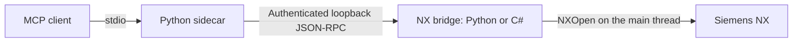

# NX MCP

**Connect MCP clients to Siemens NX for local CAD automation.**

[](https://github.com/DreamEnding/NX_MCP/actions/workflows/ci.yml)
[](pyproject.toml)
[](LICENSE)

**English** · [简体中文](README.zh-CN.md)

[Quick start](#quick-start) · [Tools](#tools) · [Example workflow](#example-workflow) · [Documentation](#documentation)

NX MCP exposes 16 typed tools for creating parts, drawing sketches, extruding
solids, inspecting model objects and exporting STEP. A Python MCP server runs
outside NX; a local bridge executes NXOpen calls inside the NX process.

> **Development preview — `0.2.0.dev0`.** Historical validation covers Python
> batch mode on NX2506 and the C# GUI bridge on NX2206. Release acceptance for
> the same clean candidate on both environments is still pending.
> See [capabilities and validation](#capabilities-and-validation).

## How it works



The sidecar handles tool schemas, input validation and MCP responses. The bridge
owns the NX session, object references, undo marks and model operations. The
sidecar can start without NX; CAD calls require a running bridge.

| Bridge | Use case | Documented runtime |
| --- | --- | --- |
| **C# GUI** | Model in an open NX window; the UI remains available between calls | NX2206 |
| **Python batch** | Run an explicitly enabled, blocking journal loop | NX2506 |

Both bridges expose the same default tool contract. Use **one bridge per state
directory**. See [architecture](docs/architecture.md) for the protocol and
[GUI bridge setup](docs/gui-bridge.md) for scheduling and deployment details.

## Quick start

### 1. Install the sidecar

You need **Windows**, a local native **Siemens NX** installation, **Python 3.10+**,
**PowerShell 7**, Git and an MCP client that supports stdio servers. Use a
disposable workspace for your first run.

```powershell
git clone https://github.com/DreamEnding/NX_MCP.git
Set-Location NX_MCP
python -m venv .venv
.\.venv\Scripts\python.exe -m pip install -e .
New-Item -ItemType Directory -Force 'C:\NX_MCP_WORKSPACE' | Out-Null
```

Run the following commands from the repository root. Replace the sample NX,
checkout and user paths with your own. If your network requires a proxy,
configure it before cloning or installing packages.

### 2. Start one NX bridge

#### Option A — Interactive C# bridge

Build against your installed NX assemblies:

```powershell
.\nx_gui_bridge\build.ps1 -NxRoot 'C:\Program Files\Siemens\NX2206'
```

Create `nx_gui_bridge/build/gui-bridge.json` next to the generated DLL:

```json
{
  "workspace": "C:\\NX_MCP_WORKSPACE",
  "state_dir": "C:\\Users\\<you>\\.nx-mcp"
}
```

In NX, choose **File → Execute → NX Open** (`Ctrl+U`) and load
`nx_gui_bridge/build/NxMcpGuiBridge.dll`. Running it again stops the bridge.
Environment variables override the JSON configuration.

Loading an unsigned DLL requires an NX Open .NET author license
(`dotnet_author`); otherwise sign it with NX's `SignDotNet.exe`.
See the [GUI bridge guide](docs/gui-bridge.md) for signing, startup loading and
client AppData isolation.

#### Option B — Python batch bridge

In a dedicated PowerShell terminal, set the bridge environment and run the
bundled journal through NX's journal runner:

```powershell
$env:NX_MCP_WORKSPACE = 'C:\NX_MCP_WORKSPACE'
$env:NX_MCP_STATE_DIR = Join-Path $env:USERPROFILE '.nx-mcp'
$env:NX_MCP_ALLOW_UNVERIFIED_PYTHON_BRIDGE = '1'
$env:NX_MCP_BRIDGE_STOP_FILE = Join-Path $env:NX_MCP_WORKSPACE "bridge-$([guid]::NewGuid()).stop"
Write-Output "Stop the bridge by creating: $env:NX_MCP_BRIDGE_STOP_FILE"
& 'C:\Program Files\Siemens\NX2506\NXBIN\run_journal.exe' (Join-Path (Get-Location) 'examples/start_nx_bridge.py')
```

This command keeps running while the bridge pumps requests. To stop it, create
the printed stop-file path from another terminal using `New-Item -ItemType File`.
The journal loads this checkout's `src/` automatically; the default Python bridge
needs no MCP or Pydantic installation inside NX. This runner is batch-only.

### 3. Configure your MCP client

Use the virtual environment's **absolute Python path**. The workspace and state
directory must match the bridge configuration, including the real username in
place of `<you>`.

```json
{
  "mcpServers": {
    "nx-mcp": {
      "command": "C:\\src\\NX_MCP\\.venv\\Scripts\\python.exe",
      "args": ["-m", "nx_mcp.server"],
      "env": {
        "NX_MCP_WORKSPACE": "C:\\NX_MCP_WORKSPACE",
        "NX_MCP_STATE_DIR": "C:\\Users\\<you>\\.nx-mcp"
      }
    }
  }
}
```

Reload the client and call `nx_status`. A connected bridge returns
`connected: true`, its NX version and `bridge_implementation` (`python_batch`
or `csharp_gui`). With no work part, `active_part` and `units` are `null`.

If you receive `NX_BRIDGE_UNAVAILABLE`, check that the bridge is running and
that both processes use the same absolute `NX_MCP_STATE_DIR`.

## Tools

The default `tools/list` contains exactly **16 tools**:

| Area | Tools |
| --- | --- |
| Session | `nx_status` |
| Part files | `nx_create_part`, `nx_open_part`, `nx_save_part`, `nx_close_part` |
| Export | `nx_export_step` |
| Inspection | `nx_list_sketches`, `nx_list_bodies`, `nx_list_features` |
| Sketches | `nx_create_sketch`, `nx_sketch_line`, `nx_sketch_rectangle`, `nx_finish_sketch` |
| Modeling | `nx_extrude` |
| Recovery and view | `nx_undo`, `nx_fit_view` |

Tools publish typed inputs, structured results and MCP operation hints. Geometry
inputs use the work part's **native units**, reported by `nx_status.units` as
`mm` or `inch`. If units are missing or `null`, confirm them before modeling.

The 34 legacy tools are hidden and unverified. Their opt-in settings are
explained in the [0.1 migration guide](docs/migration-0.2.md); the C# bridge does
not support them. STEP-to-USD conversion is a [separate validation example](docs/usd-validation.md),
not an MCP tool. Measurement APIs remain [proposals](docs/inspection-contract.md).

## Example workflow

Create a **20 × 10 × 12.5 mm** block in a new part. These are MCP tool calls,
not a Python script; pass each row's arguments through your client.
Use fresh output paths and confirm the intended work part before making changes.

| Step | Tool | Arguments or result to retain |
| --- | --- | --- |
| 1 | `nx_status` | Check the active part and connection |
| 2 | `nx_create_part` | `{"path":"demo/block.prt","units":"mm"}` |
| 3 | `nx_create_sketch` | `{"plane":"XY"}`; retain `object.id` as `sketch_id` |
| 4 | `nx_sketch_rectangle` | `{"sketch_id":"<id>","corner1":{"x":0,"y":0},"corner2":{"x":20,"y":10}}` |
| 5 | `nx_finish_sketch` | `{"sketch_id":"<id>"}` |
| 6 | `nx_extrude` | `{"sketch_id":"<id>","distance":12.5}` |
| 7 | `nx_list_bodies`, `nx_list_features` | Check the returned body and feature |
| 8 | `nx_save_part` | `{}` |
| 9 | `nx_export_step` | `{"path":"demo/block.stp"}` |

Replace `<id>` with the actual sketch ID from step 3. The example uses XY;
XZ/YZ line and rectangle coordinate handling currently needs correction.
Object lists verify model structure, not exact dimensional measurements.
The [NX modeling skill](skills/nx-modeling/SKILL.md) describes unit handling,
part ownership, verification and recovery for agents.

## Operational boundaries

- **Files:** pass paths relative to `NX_MCP_WORKSPACE`. Both processes validate
  file boundaries. Geometry commands operate on the current work part, so
  establish the target part before editing.
- **Save and close:** operate on the work part, not its whole assembly tree.
  An incomplete save returns an error, preserves undo history and prevents
  save-before-close from discarding the part.
- **Object IDs:** are session references, not permanent asset IDs. Query fresh
  IDs after undo, failed-mutation rollback or closing/reopening a part.
- **Recovery:** never automatically replay a mutation whose
  `details.execution_state` is `unknown`. Inspect the model first. A rollback
  failure blocks writes until explicit recovery; see the [recovery contract](docs/architecture.md#object-and-operation-lifecycle).
- **Local access:** the bridge binds to `127.0.0.1` and authenticates requests.
  Keep the state directory private: `bridge.json` contains the session token.
  Remote exposure and Teamcenter-managed sessions are outside the current scope.

## Capabilities and validation

Default availability, automated tests and real-NX acceptance are separate claims.

| Area | Evidence and remaining boundary |
| --- | --- |
| Default modeling workflow | Development-tree NX2506 batch acceptance; clean release-candidate matrix pending |
| Interactive GUI bridge | Historical NX2206 acceptance; matching current-candidate acceptance pending |
| Native units | Metric/inch save/reopen verified on development-tree Python/NX2506; GUI runtime validation pending |
| Failure and recovery paths | Local fault-injection tests; no blanket real-NX acceptance of every error branch |
| Legacy tools and USD conversion | Outside the default tool surface; separate validation requirements |

See [real-NX validation](docs/real-nx-validation.md), [M1 status](docs/m1-status.md),
[M2 status](docs/m2-status.md) and the [release checklist](RELEASE.md) for exact
builds, dates and acceptance criteria. A fake-NX test or successful C# build does
not certify native CAD behavior.

## Development

Use the repository virtual environment from PowerShell 7:

```powershell
.\.venv\Scripts\Activate.ps1
python -m pip install -e ".[dev]"
python -m pre_commit install --install-hooks
python -m pre_commit run --all-files
python -m mypy src/nx_mcp
python -m pytest -q -p no:cacheprovider -m "not real_nx" --cov=nx_mcp --cov-branch --cov-fail-under=78
```

Ordinary tests do not require NX. CI runs Python tests, coverage, packaging,
contract parity and isolated Windows C# harnesses. Real-NX acceptance runs
separately on a dedicated runner. See [contributing](CONTRIBUTING.md) before
adding tools or collecting release evidence.

## Documentation

| Guide | What it covers |
| --- | --- |
| [Architecture](docs/architecture.md) | Process boundaries, protocol, object lifecycle and recovery |
| [GUI bridge](docs/gui-bridge.md) | C# build, configuration, loading and NX2206 evidence |
| [Real-NX validation](docs/real-nx-validation.md) | Batch setup, acceptance commands and runtime evidence |
| [NX modeling skill](skills/nx-modeling/SKILL.md) | Agent workflow using the existing tools |
| [0.1 → 0.2 migration](docs/migration-0.2.md) | Tool and parameter changes |
| [MCP SDK v2 migration](docs/migration-mcp-sdk-2.md) | Official Python SDK dependencies and client compatibility |
| [STEP → USD validation](docs/usd-validation.md) | Independent conversion and geometry checks |
| [Inspection contract](docs/inspection-contract.md) | Implemented units and proposed measurement APIs |

[Changelog](CHANGELOG.md) · [Release checklist](RELEASE.md) · [Security policy](SECURITY.md) · [MIT license](LICENSE)

<details>
<summary>Star history</summary>

<picture>
  <source media="(prefers-color-scheme: dark)" srcset="https://raw.githubusercontent.com/DreamEnding/NX_MCP/star-history/assets/star-history-dark.svg" />
  
</picture>

The chart is maintained on the separate `star-history` branch.

</details>
