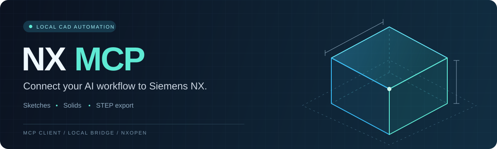
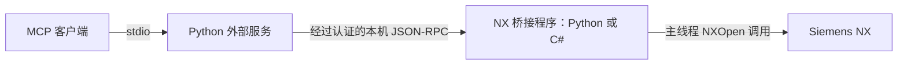

<p align="center">
  
</p>

<h1 align="center">NX MCP</h1>

<p align="center"><strong>通过 MCP 客户端连接 Siemens NX，实现本地 CAD 自动化。</strong></p>

<p align="center">
  <a href="https://github.com/DreamEnding/NX_MCP/actions/workflows/ci.yml"></a>
  <a href="pyproject.toml"></a>
  <a href="LICENSE"></a>
  <a href="https://github.com/DreamEnding/NX_MCP/stargazers"></a>
</p>

<p align="center"><a href="README.md">English</a> · <strong>简体中文</strong></p>

<p align="center"><a href="#快速开始">快速开始</a> · <a href="#工具列表">工具列表</a> · <a href="#建模示例">建模示例</a> · <a href="#文档导航">文档导航</a></p>

---

NX MCP 提供 16 个具有类型定义的工具，用于创建零件、绘制草图、拉伸实体、查询模型对象和导出 STEP。
Python MCP 服务在 NX 进程外运行，本地桥接程序在 NX 进程内执行 NXOpen 调用。

> [!IMPORTANT]
>
> **开发预览版 — `0.2.0.dev0`。** 历史验证覆盖 NX2506 上的 Python 批处理桥和
> NX2206 上的 C# GUI 桥。同一干净候选版本在两种环境中的发布验收仍待完成。
> 详见[能力与验证状态](#能力与验证状态)。

| 绘制与建模 | 检查与恢复 | 保存与导出 |
| :--- | :--- | :--- |
| 创建草图、绘制直线与矩形、拉伸实体。 | 查询实体和特征，撤销操作并适配视图。 | 打开和保存 NX 零件，导出 STEP 文件。 |

## 工作原理



外部服务负责工具 schema、输入校验和 MCP 响应；桥接程序负责 NX 会话、对象引用、撤销标记和模型操作。
外部服务可以在没有 NX 的环境中启动，CAD 调用则需要已运行的桥接程序。

| 桥接方式 | 适用场景 | 已有运行记录 |
| --- | --- | --- |
| **C# GUI** | 在打开的 NX 窗口中建模，调用之间界面保持可操作 | NX2206 |
| **Python 批处理** | 显式启用，通过阻塞式 Journal 循环执行操作 | NX2506 |

两种桥接方式提供相同的默认工具接口。**每个状态目录只运行一个桥接程序。**
协议设计见[架构文档](docs/architecture.md)，GUI 调度和部署细节见[GUI 桥接指南](docs/gui-bridge.md)。

## 快速开始

### 1. 安装外部服务

需要 **Windows**、本机原生 **Siemens NX**、**Python 3.10+**、**PowerShell 7**、Git，
以及支持 stdio 服务的 MCP 客户端。首次运行请使用可丢弃的测试工作区。

```powershell
git clone https://github.com/DreamEnding/NX_MCP.git
Set-Location NX_MCP
python -m venv .venv
.\.venv\Scripts\python.exe -m pip install -e .
New-Item -ItemType Directory -Force 'C:\NX_MCP_WORKSPACE' | Out-Null
```

后续命令均在仓库根目录执行。请将示例中的 NX 安装路径、仓库路径和用户路径替换为实际值。
如果网络需要代理，请在克隆或安装依赖前完成代理配置。

### 2. 启动一种 NX 桥接程序

<details>
<summary><strong>方案 A — C# 交互式桥接</strong></summary>

使用本机 NX 程序集编译：

```powershell
.\nx_gui_bridge\build.ps1 -NxRoot 'C:\Program Files\Siemens\NX2206'
```

在生成的 DLL 旁创建 `nx_gui_bridge/build/gui-bridge.json`：

```json
{
  "workspace": "C:\\NX_MCP_WORKSPACE",
  "state_dir": "C:\\Users\\<you>\\.nx-mcp"
}
```

在 NX 中选择 **File → Execute → NX Open**（`Ctrl+U`），加载
`nx_gui_bridge/build/NxMcpGuiBridge.dll`。再次运行可停止桥接。
环境变量的优先级高于 JSON 配置。

加载未签名 DLL 需要 NX Open .NET 作者许可证（`dotnet_author`）；
否则需使用 NX 的 `SignDotNet.exe` 签名。
签名、启动时加载和客户端 AppData 隔离问题详见[GUI 桥接指南](docs/gui-bridge.md)。

</details>

<details>
<summary><strong>方案 B — Python 批处理桥接</strong></summary>

在专用 PowerShell 终端中设置桥接环境，然后通过 NX Journal Runner 运行示例脚本：

```powershell
$env:NX_MCP_WORKSPACE = 'C:\NX_MCP_WORKSPACE'
$env:NX_MCP_STATE_DIR = Join-Path $env:USERPROFILE '.nx-mcp'
$env:NX_MCP_ALLOW_UNVERIFIED_PYTHON_BRIDGE = '1'
$env:NX_MCP_BRIDGE_STOP_FILE = Join-Path $env:NX_MCP_WORKSPACE "bridge-$([guid]::NewGuid()).stop"
Write-Output "Stop the bridge by creating: $env:NX_MCP_BRIDGE_STOP_FILE"
& 'C:\Program Files\Siemens\NX2506\NXBIN\run_journal.exe' (Join-Path (Get-Location) 'examples/start_nx_bridge.py')
```

命令会持续运行并处理请求。停止时，在另一个终端使用 `New-Item -ItemType File` 创建输出中显示的停止文件。
Journal 会自动加载当前仓库的 `src/`；默认 Python 桥无需在 NX 内安装 MCP 或 Pydantic。
该运行方式仅用于批处理。

</details>

### 3. 配置 MCP 客户端

使用虚拟环境中 Python 的**绝对路径**。工作区和状态目录必须与桥接配置一致，
并将 `<you>` 替换为实际用户名。

```json
{
  "mcpServers": {
    "nx-mcp": {
      "command": "C:\\src\\NX_MCP\\.venv\\Scripts\\python.exe",
      "args": ["-m", "nx_mcp.server"],
      "env": {
        "NX_MCP_WORKSPACE": "C:\\NX_MCP_WORKSPACE",
        "NX_MCP_STATE_DIR": "C:\\Users\\<you>\\.nx-mcp"
      }
    }
  }
}
```

重新加载客户端并调用 `nx_status`。连接成功时返回 `connected: true`、NX 版本，
以及 `bridge_implementation`（`python_batch` 或 `csharp_gui`）。
没有工作零件时，`active_part` 和 `units` 均为 `null`。

如果返回 `NX_BRIDGE_UNAVAILABLE`，请检查桥接程序是否已启动，以及两个进程是否使用相同的绝对路径 `NX_MCP_STATE_DIR`。

## 工具列表

默认 `tools/list` 仅包含以下 **16 个工具**：

| 类别 | 工具 |
| --- | --- |
| 会话状态 | `nx_status` |
| 零件文件 | `nx_create_part`、`nx_open_part`、`nx_save_part`、`nx_close_part` |
| 导出 | `nx_export_step` |
| 对象查询 | `nx_list_sketches`、`nx_list_bodies`、`nx_list_features` |
| 草图 | `nx_create_sketch`、`nx_sketch_line`、`nx_sketch_rectangle`、`nx_finish_sketch` |
| 建模 | `nx_extrude` |
| 恢复与视图 | `nx_undo`、`nx_fit_view` |

工具提供类型化输入、结构化结果和 MCP 操作提示。
几何输入使用工作零件的**原生单位**，由 `nx_status.units` 返回 `mm` 或 `inch`。
若单位缺失或为 `null`，请先确认单位再建模。

其余 34 个旧版工具默认隐藏且未经验证，启用条件见[0.1 迁移指南](docs/migration-0.2.md)，
C# 桥不支持这些工具。STEP 转 USD 是[独立验证示例](docs/usd-validation.md)，不是 MCP 工具。
测量 API 仍处于[方案设计阶段](docs/inspection-contract.md)。

## 建模示例

在新零件中创建一个 **20 × 10 × 12.5 mm** 的长方体。
下表是 MCP 工具调用顺序，不是 Python 脚本；请通过客户端传入对应参数。
使用尚未存在的输出路径，并在修改前确认目标工作零件。

| 步骤 | 工具 | 参数或需要保留的结果 |
| --- | --- | --- |
| 1 | `nx_status` | 检查连接和当前零件 |
| 2 | `nx_create_part` | `{"path":"demo/block.prt","units":"mm"}` |
| 3 | `nx_create_sketch` | `{"plane":"XY"}`；将 `object.id` 保存为 `sketch_id` |
| 4 | `nx_sketch_rectangle` | `{"sketch_id":"<id>","corner1":{"x":0,"y":0},"corner2":{"x":20,"y":10}}` |
| 5 | `nx_finish_sketch` | `{"sketch_id":"<id>"}` |
| 6 | `nx_extrude` | `{"sketch_id":"<id>","distance":12.5}` |
| 7 | `nx_list_bodies`、`nx_list_features` | 检查返回的实体和特征 |
| 8 | `nx_save_part` | `{}` |
| 9 | `nx_export_step` | `{"path":"demo/block.stp"}` |

将 `<id>` 替换为第 3 步实际返回的草图 ID。示例使用 XY 平面；
XZ/YZ 平面的直线和矩形坐标处理目前仍需修正。
对象列表只能验证模型结构，不能代替精确尺寸测量。
[NX 建模技能](skills/nx-modeling/SKILL.md)说明了智能体应如何处理单位、零件归属、结果验证和错误恢复。

## 操作边界

- **文件路径：**传入相对于 `NX_MCP_WORKSPACE` 的路径，两端都会检查文件边界。
  几何命令操作当前工作零件，因此修改前需先确定目标零件。
- **保存与关闭：**仅作用于工作零件，不遍历整个装配树。
  保存不完整时返回错误并保留撤销历史；“保存后关闭”不会继续丢弃该零件。
- **对象 ID：**是会话引用，不是永久资产标识。撤销、失败操作回滚或关闭并重新打开零件后，需查询新的 ID。
- **错误恢复：**当 `details.execution_state` 为 `unknown` 时，不要自动重放修改命令，应先检查模型。
  回滚失败会阻止后续写入，直到完成显式恢复；详见[恢复约定](docs/architecture.md#object-and-operation-lifecycle)。
- **本机访问：**桥接仅监听 `127.0.0.1`，并对请求进行认证。
  状态目录应仅供当前用户访问，因为 `bridge.json` 包含会话令牌。
  远程网络暴露和 Teamcenter 托管会话不在当前支持范围内。

## 能力与验证状态

默认可用、自动化测试通过和真实 NX 验收是不同的结论。

| 范围 | 已有证据与待验证边界 |
| --- | --- |
| 默认建模流程 | 开发工作区已通过 NX2506 批处理验收；干净发布候选的完整矩阵仍待验证 |
| 交互式 GUI 桥 | 有 NX2206 历史验收记录；当前对应候选版本仍待验收 |
| 原生单位 | 开发工作区的 Python/NX2506 已验证毫米及英寸零件保存后重开；GUI 运行验证待完成 |
| 失败与恢复分支 | 有本地故障注入测试；并非所有错误分支都完成了真实 NX 验收 |
| 旧版工具与 USD 转换 | 不属于默认工具接口，分别有独立验证要求 |

具体版本、日期和验收标准见[真实 NX 验证](docs/real-nx-validation.md)、
[M1 状态](docs/m1-status.md)、[M2 状态](docs/m2-status.md)和[发布检查清单](RELEASE.md)。
假 NX 测试或 C# 编译成功不能证明原生 CAD 行为已通过验收。

## 开发

在 PowerShell 7 中使用仓库虚拟环境：

```powershell
.\.venv\Scripts\Activate.ps1
python -m pip install -e ".[dev]"
python -m pre_commit install --install-hooks
python -m pre_commit run --all-files
python -m mypy src/nx_mcp
python -m pytest -q -p no:cacheprovider -m "not real_nx" --cov=nx_mcp --cov-branch --cov-fail-under=78
```

普通测试不需要 NX。CI 执行 Python 测试、覆盖率检查、打包、接口一致性检查，以及隔离的 Windows C# 测试程序。
真实 NX 验收在专用运行器上单独执行。新增工具或收集发布证据前，请阅读[贡献指南](CONTRIBUTING.md)。

## 文档导航

详细技术文档目前以英文为主。

| 文档 | 内容 |
| --- | --- |
| [架构](docs/architecture.md) | 进程边界、协议、对象生命周期与恢复 |
| [GUI 桥接](docs/gui-bridge.md) | C# 编译、配置、加载和 NX2206 验证记录 |
| [真实 NX 验证](docs/real-nx-validation.md) | 批处理配置、验收命令与运行证据 |
| [NX 建模技能](skills/nx-modeling/SKILL.md) | 使用现有工具的智能体建模流程 |
| [0.1 → 0.2 迁移](docs/migration-0.2.md) | 工具与参数变化 |
| [MCP SDK v2 迁移](docs/migration-mcp-sdk-2.md) | 官方 Python SDK 依赖与客户端兼容性 |
| [STEP → USD 验证](docs/usd-validation.md) | 独立转换与几何检查 |
| [查询与测量约定](docs/inspection-contract.md) | 已实现的单位约定和测量 API 提案 |

[变更记录](CHANGELOG.md) · [发布检查清单](RELEASE.md) · [安全策略](SECURITY.md) · [MIT 许可证](LICENSE)

## Star 历史

如果 NX MCP 对你有帮助，欢迎点亮 Star，或通过 Issue 分享使用反馈。

<p align="center">
  <a href="https://star-history.com/#DreamEnding/NX_MCP&amp;Date">
    <picture>
      <source media="(prefers-color-scheme: dark)" srcset="https://api.star-history.com/svg?repos=DreamEnding/NX_MCP&amp;type=Date&amp;theme=dark" />
      <source media="(prefers-color-scheme: light)" srcset="https://api.star-history.com/svg?repos=DreamEnding/NX_MCP&amp;type=Date" />
      
    </picture>
  </a>
</p>

[查看交互图表](https://star-history.com/#DreamEnding/NX_MCP&Date) · [查看每日归档](https://raw.githubusercontent.com/DreamEnding/NX_MCP/star-history/assets/star-history.svg)
